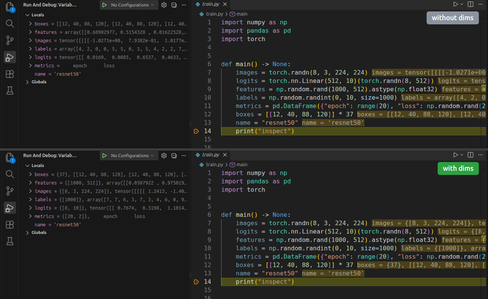

<div align="center">


# dims

**Tensor shapes, right in the VS Code debugger.**

Stop typing `.shape` in the debug console.

[](https://github.com/marekprovaznik/dims/actions/workflows/ci.yml)
[](https://marketplace.visualstudio.com/items?itemName=provaznik.dims)
[](https://marketplace.visualstudio.com/items?itemName=provaznik.dims)
[](https://open-vsx.org/extension/provaznik/dims)
[](LICENSE)


[](https://buymeacoffee.com/provaznik)

</div>

---



```text
VARIABLES                                   VARIABLES  (with dims)
  x = tensor([[0.1, 0.4, ...]])     ──►       x = {[8, 3, 224, 224]}, tensor([[0.1, 0.4, ...]])
  m = array([[1., 0.], ...])        ──►       m = {[512, 512]}, array([[1., 0.], ...])
  df =     a    b ...               ──►       df = {[10000, 12]},     a    b ...
  boxes = [[12, 40, 88, 120], ...]  ──►       boxes = {37}, [[12, 40, 88, 120], ...]
```

The shape sits in front of every array, tensor and DataFrame; containers get their length. Nothing to configure: install, hit **F5**, read shapes.

## Features

- **Shapes for anything with `.shape`**: NumPy, PyTorch, TensorFlow, JAX, pandas, h5py, ...
- **Lengths for sized containers**: `list`, `tuple`, `dict`, `set`, `range`, ...
- **No slowdown on huge objects**: values go through pydevd's size-bounded `SafeRepr`; a 5M-element list renders in milliseconds.
- **pandas included**: debugpy's built-in DataFrame/Series presenters get the shape too.
- **Clean copies**: *Copy Value* gives the plain value, without the prefix.
- **Quiet on strings**: `str`, `bytes` and `bytearray` are left alone.

## Install

Search for **dims** in the Extensions view (`Ctrl+Shift+X`), or run:

```bash
code --install-extension provaznik.dims
```

Cursor, Windsurf and VSCodium install it the same way from [Open VSX](https://open-vsx.org/extension/provaznik/dims).

Each [GitHub release](https://github.com/marekprovaznik/dims/releases/latest) also carries the `.vsix` for offline installs (`code --install-extension dims-<version>.vsix`).

If you previously patched debugpy by hand to show shapes (a `SizedShapeStr` provider in `pydevd_plugins/extensions/types/`), remove that file: it takes precedence over dims and renders values with an unbounded `str()`.

Then start any Python **launch** debug session.

## Supported types

| Type | Shows | Example | Tested in CI |
|------|-------|---------|:---:|
| NumPy `ndarray` | shape | `{[2, 3]}, array(...)` | ✅ |
| PyTorch `Tensor` | shape | `{[2, 3]}, tensor(...)` | ✅ |
| pandas `DataFrame` / `Series` | shape | `{[100, 5]}, ...` | ✅ |
| TensorFlow / JAX arrays | shape | `{[2, 3]}, ...` | — |
| `list`, `tuple`, `dict`, `set`, `range` | length | `{3}, [1, 2, 3]` | ✅ |
| `str`, `bytes`, `bytearray` | unchanged | `'hello'` | ✅ |

## How it works

1. **F5** starts a Python launch session.
2. dims prepends its bundled `python/` directory to the debuggee's `PYTHONPATH` (entries from `env` and `envFile` are kept).
3. pydevd inside debugpy discovers `pydevd_plugins.extensions.pydevd_plugin_dims`.
4. The Variables view shows `{[8, 3, 224, 224]}, tensor(...)`.

dims uses debugpy's [pydevd extension API](https://github.com/microsoft/debugpy/tree/main/src/debugpy/_vendored/pydevd/pydevd_plugins/extensions): a `StrPresentationProvider` that prepends the shape to pydevd's own value string. Nothing is patched on disk, so debugpy updates don't remove it.

## Known limitations

dims can only add its plugin to processes the debugger **launches**. These are not covered automatically:

- **Attach sessions** (`"request": "attach"`): a training job on a cluster, in a container, or started with `python -m debugpy --listen ...`.
- **Notebook / Jupyter debugging**: the kernel is started outside the debug launch (untested).

Workaround: the plugin is a single file with no dependencies. Put [`pydevd_plugin_dims.py`](python/pydevd_plugins/extensions/pydevd_plugin_dims.py) into a `pydevd_plugins/extensions/` directory and add that directory's parent to the target process's `PYTHONPATH` before it starts:

```bash
mkdir -p ~/dims/pydevd_plugins/extensions
curl -sL https://raw.githubusercontent.com/marekprovaznik/dims/master/python/pydevd_plugins/extensions/pydevd_plugin_dims.py \
    -o ~/dims/pydevd_plugins/extensions/pydevd_plugin_dims.py
PYTHONPATH=~/dims:$PYTHONPATH python -m debugpy --listen 5678 --wait-for-client train.py
```

Launch sessions over Remote-SSH, Dev Containers and WSL should work as usual: install dims on the remote side like any other extension.

## Configuration

| Setting | Default | Description |
|---------|---------|-------------|
| `dims.enabled` | `true` | Enable/disable shape display |

## Development

```bash
npm ci && npm run compile && npx vsce package        # extension
pip install -r requirements-dev.txt                  # plugin tests
python -m pytest tests
npm test                                             # end-to-end, needs python3 with numpy
npm run demo                                         # re-render images/demo.png, needs numpy, pandas, torch and ffmpeg
```

CI runs the plugin tests against real pydevd on Linux, macOS and Windows (Python 3.9 and 3.13, PyTorch on Linux 3.13), plus ruff and `vsce package`. The end-to-end test (`npm test`) launches VS Code with the Python Debugger extension, stops at a breakpoint in `src/test/fixture/script.py` and checks the values the Variables view receives; set `DIMS_E2E_PYTHON` to pick the interpreter.

## Support

dims is free and MIT-licensed, and stays that way. If it saved you some debugging time, you can buy me a coffee — thank you!

<a href="https://buymeacoffee.com/provaznik"></a>

Bug reports and ideas in [Issues](https://github.com/marekprovaznik/dims/issues) help just as much.

## License

[MIT](LICENSE)
