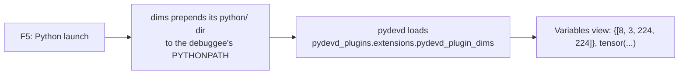

<div align="center">


# dims

**Tensor shapes, right in the VS Code debugger.**

Stop typing `.shape` in the debug console.

[](https://github.com/AddictionLord/dims/actions/workflows/ci.yml)
[](https://github.com/AddictionLord/dims/tags)
[](LICENSE)


</div>

---

```text
VARIABLES                                   VARIABLES  (with dims)
  x = tensor([[0.1, 0.4, ...]])     ──►       x = {[8, 3, 224, 224]}, tensor([[0.1, 0.4, ...]])
  m = array([[1., 0.], ...])        ──►       m = {[512, 512]}, array([[1., 0.], ...])
  df =     a    b ...               ──►       df = {[10000, 12]},     a    b ...
  boxes = [[12, 40, 88, 120], ...]  ──►       boxes = {37}, [[12, 40, 88, 120], ...]
```

The shape sits in front of every array, tensor and DataFrame; containers get their length. Nothing to configure: install, hit **F5**, read shapes.

## Features

- **Shapes for anything with `.shape`**: NumPy, PyTorch, TensorFlow, JAX, pandas, h5py, ...
- **Lengths for sized containers**: `list`, `tuple`, `dict`, `set`, `range`, ...
- **No slowdown on huge objects**: values go through pydevd's size-bounded `SafeRepr`; a 5M-element list renders in milliseconds.
- **pandas included**: debugpy's built-in DataFrame/Series presenters get the shape too.
- **Clean copies**: *Copy Value* gives the plain value, without the prefix.
- **Quiet on strings**: `str`, `bytes` and `bytearray` are left alone.

## Install

dims is not on the Marketplace yet. Grab the `.vsix` from the [latest release](https://github.com/AddictionLord/dims/releases/latest) and install it:

```bash
code --install-extension dims-0.1.0.vsix
```

Every version bump in `package.json` that lands on `master` is tagged and released automatically.

Then start any Python **launch** debug session.

## Supported types

| Type | Shows | Example | Tested in CI |
|------|-------|---------|:---:|
| NumPy `ndarray` | shape | `{[2, 3]}, array(...)` | ✅ |
| PyTorch `Tensor` | shape | `{[2, 3]}, tensor(...)` | ✅ when torch is installed |
| pandas `DataFrame` / `Series` | shape | `{[100, 5]}, ...` | ✅ |
| TensorFlow / JAX arrays | shape | `{[2, 3]}, ...` | — |
| `list`, `tuple`, `dict`, `set`, `range` | length | `{3}, [1, 2, 3]` | ✅ |
| `str`, `bytes`, `bytearray` | unchanged | `'hello'` | ✅ |

## How it works



dims uses debugpy's [pydevd extension API](https://github.com/microsoft/debugpy/tree/main/src/debugpy/_vendored/pydevd/pydevd_plugins/extensions): a `StrPresentationProvider` that prepends the shape to pydevd's own value string. Nothing is patched on disk, so debugpy updates don't remove it.

**Limitation:** attach sessions are not covered. dims can only add the plugin to processes the debugger launches.

## Configuration

| Setting | Default | Description |
|---------|---------|-------------|
| `dims.enabled` | `true` | Enable/disable shape display |

## Development

```bash
npm ci && npm run compile && npx vsce package        # extension
pip install -r requirements-dev.txt                  # plugin tests
python -m pytest tests
```

CI runs the plugin tests against real pydevd on Linux, macOS and Windows (Python 3.9 and 3.13), plus ruff and `vsce package`.

## License

[MIT](LICENSE)
